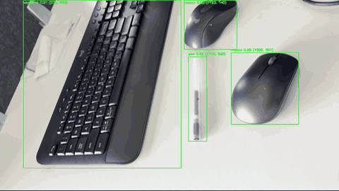

# Vision Target Tracker

Object detection and centroid localization on video, using a custom-trained YOLO11 model, Roboflow serverless inference and OpenCV.



The tracker runs a video through a detector frame by frame. For every object it finds, it outputs the class, the confidence and the centre point of the object in pixels, written as (u, v). It then saves an annotated copy of the video.

A pixel centroid is the first step for robot tasks such as grasping and visual servoing: once you know where a part is in the image, you can steer a gripper or camera towards it. This project builds that first stage as a small, modular pipeline.

## How it works

1. **Collect data.** `scripts/extract_frames.py` samples 4 frames per second from a recorded desk video into `data/raw/` for labelling.
2. **Train the model.** The frames were labelled in Roboflow and used to train a YOLO11n model on simple desk objects (keyboard, mouse, pen).
3. **Run inference.** `main.py` reads the input video with OpenCV and sends each frame to a Roboflow serverless workflow over HTTPS.
4. **Compute centroids.** For each detection, the centroid comes from the bounding box:

   $$u = x_{\min} + \frac{w}{2}, \quad v = y_{\min} + \frac{h}{2}$$

5. **Draw the overlay.** Each object gets a bounding box, a centroid dot and a label with its class, confidence and (u, v). The frames are written to an MP4.

If inference fails on a frame, the script logs a warning and keeps going, so one bad request doesn't stop the run.

## Setup

Requires Python 3.9 or newer.

```bash
git clone https://github.com/MenakanT/vision-target-tracker.git
cd vision-target-tracker
pip install -r requirements.txt
```

Create a `.env` file in the project root with your Roboflow API key. It is git-ignored, so the key never gets committed.

```
ROBOFLOW_API_KEY=your_key_here
```

`main.py` calls a workflow in the `menakant` Roboflow workspace. To use your own model, change `workspace_name` and `workflow_id` in `main.py`.

## Usage

**Track objects in a video.** Put the input video at `assets/trial_video.mov`, then run:

```bash
python main.py
```

The annotated video is saved to `assets/output_tracked.mp4`, and progress is printed every 10 frames.

**Extract frames for labelling.** Put the source video at `assets/desk_video2.mov`, then run:

```bash
python scripts/extract_frames.py
```

The frames are saved to `data/raw/` as `frame_000.jpg`, `frame_001.jpg` and so on.

## Repository structure

```text
vision-target-tracker/
├── assets/
│   └── demo.gif             # Demo clip used in this README
├── scripts/
│   └── extract_frames.py    # Samples frames from a video for labelling
├── main.py                  # Inference, centroid extraction and video overlay
├── requirements.txt         # Python dependencies
└── README.md
```

## Limitations and next steps

- Every frame is a separate HTTPS request, so the speed depends on the network. It processes recorded video, not a live camera at full frame rate.
- Detections are independent per frame. There is no tracking ID that follows an object between frames yet.
- Centroids are in 2D pixel coordinates. Turning them into 3D positions a robot can use needs camera calibration and depth.

Planned next steps:

- Run the model locally (for example with Ultralytics) for real-time inference on a live camera.
- Add multi-object tracking (such as ByteTrack) so each object keeps its ID.
- Use a depth camera and calibration to output 3D target positions for a robot arm.
